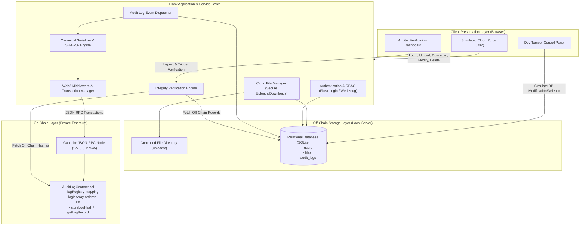
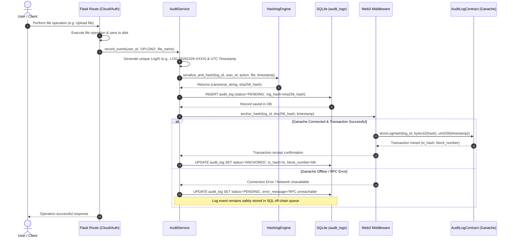
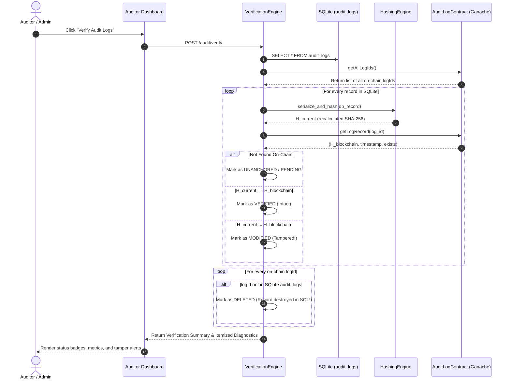

# ARCHITECTURE SPECIFICATION: Blockchain-Based Secure Cloud Audit Logging

**Project**: B.Tech CSE Major Project (2026–2027)  
**Authors**: Shourya Upadhyay (`2410031159`) & Jeevesh Pachauri (`2410031186`)  
**Guide**: Prof. Dr. Leena Arya, IILM University, Greater Noida  

---

## 1. High-Level Architectural Overview

The **Blockchain-Based Secure Cloud Audit Logging System** employs a **4-Tier Hybrid Architecture**. It combines the query speed and storage capacity of a traditional relational database (off-chain) with the cryptographic immutability and non-repudiation of a private Ethereum blockchain (on-chain).



---

## 2. Canonical Serialization & Cryptographic Hashing Specification

To guarantee that recalculating a hash during an audit produces an exact match with the original on-chain hash, the system enforces a strict canonical serialization protocol.

### 2.1 Canonical Field Order
Every audit event is serialized using exactly five fields in this order:

$$\text{Canonical String} = \text{LogID} \parallel \text{" | "} \parallel \text{UserID} \parallel \text{" | "} \parallel \text{ActionType} \parallel \text{" | "} \parallel \text{FileName} \parallel \text{" | "} \parallel \text{Timestamp}$$

### 2.2 Formatting and Encoding Rules
1. **Delimiter**: The pipe character surrounded by single spaces (`" | "`).
2. **Character Escaping**: If any field value (e.g. `FileName` or `UserID`) contains a literal pipe character (`|`), it MUST be escaped as `\|` prior to serialization, or rejected by input validation.
3. **Field Trimming**: All string values are stripped of leading and trailing whitespace.
4. **Action Types**: Case-normalized uppercase string: `LOGIN`, `UPLOAD`, `DOWNLOAD`, `MODIFY`, or `DELETE`.
5. **Special Cases**: For actions not tied to a file (such as `LOGIN`), the `FileName` field is canonically set to `"SESSION"`.
6. **Timestamp Format**: Strict ISO-8601 UTC format: `YYYY-MM-DDTHH:MM:SSZ` (e.g., `2026-10-29T18:30:00Z`).
7. **Encoding**: UTF-8 bytes representation before hashing.

### 2.3 Cryptographic Hashing Function
The UTF-8 bytes are passed to the standard **SHA-256** hash algorithm:

$$\text{Digest} = \text{SHA-256}(\text{Canonical String UTF-8 Bytes})$$

- Output: 64-character lowercase hexadecimal string (e.g., `a3f8c...`).
- Blockchain representation: Converted to Solidity `bytes32` prefixed with `0x` (e.g., `web3.to_bytes(hexstr=hash_hex)`).

### 2.4 Mathematical Invariance Proof
For any given audit record $R_i = \{id_i, u_i, a_i, f_i, t_i\}$, the serializer $S(R_i)$ is deterministic:
$$S(R_i) = S(R_i') \iff R_i = R_i'$$
By the collision-resistance property of SHA-256:
$$\text{SHA-256}(S(R_i)) = \text{SHA-256}(S(R_i')) \implies R_i = R_i' \quad (\text{with negligible failure probability } < 2^{-128})$$

---

## 3. Data Flow & Sequence Workflows

### 3.1 Real-Time Activity Logging & Hash Anchoring



---

### 3.2 Audit Trail Verification & Tamper Detection



---

## 4. Database Schema Design (SQLite)

### Table: `users`
Stores user credentials and access permissions.

| Column Name | Data Type | Constraints | Description |
|---|---|---|---|
| `id` | INTEGER | PRIMARY KEY AUTOINCREMENT | Unique user identifier |
| `username` | VARCHAR(64) | UNIQUE NOT NULL | User login name |
| `password_hash` | VARCHAR(255) | NOT NULL | Werkzeug-generated PBKDF2 hash |
| `role` | VARCHAR(20) | NOT NULL DEFAULT 'user' | Access role: `'user'` or `'auditor'` |
| `created_at` | DATETIME | NOT NULL DEFAULT CURRENT_TIMESTAMP | Account creation timestamp |

### Table: `files`
Stores metadata of files held in the simulated cloud storage portal.

| Column Name | Data Type | Constraints | Description |
|---|---|---|---|
| `id` | INTEGER | PRIMARY KEY AUTOINCREMENT | Unique file identifier |
| `filename` | VARCHAR(255) | NOT NULL | Sanitized display filename |
| `stored_filename`| VARCHAR(255) | UNIQUE NOT NULL | UUID-prefixed physical filename on disk |
| `filesize` | INTEGER | NOT NULL | File size in bytes |
| `owner_id` | INTEGER | NOT NULL, FOREIGN KEY(`users.id`) | ID of the user who owns the file |
| `upload_date` | DATETIME | NOT NULL DEFAULT CURRENT_TIMESTAMP | Initial upload timestamp |
| `last_modified` | DATETIME | NOT NULL DEFAULT CURRENT_TIMESTAMP | Last content modification timestamp |

### Table: `audit_logs`
Stores off-chain audit logs and their corresponding blockchain anchoring status.

| Column Name | Data Type | Constraints | Description |
|---|---|---|---|
| `id` | INTEGER | PRIMARY KEY AUTOINCREMENT | Internal relational row ID |
| `log_id` | VARCHAR(64) | UNIQUE NOT NULL | Unique audit event identifier (e.g. `LOG-20261029-XXXX`) |
| `user_id` | VARCHAR(64) | NOT NULL | Username or ID of the actor |
| `action_type` | VARCHAR(20) | NOT NULL | `LOGIN`, `UPLOAD`, `DOWNLOAD`, `MODIFY`, or `DELETE` |
| `file_name` | VARCHAR(255) | NOT NULL | File target name or `'SESSION'` |
| `timestamp` | VARCHAR(30) | NOT NULL | ISO-8601 UTC timestamp string |
| `log_hash` | VARCHAR(66) | NOT NULL | Computed SHA-256 hex digest (`0x...`) |
| `tx_hash` | VARCHAR(66) | NULLABLE | Ethereum transaction hash (populated upon anchor) |
| `block_number` | INTEGER | NULLABLE | Block number containing the record |
| `anchored_status`| VARCHAR(20) | NOT NULL DEFAULT 'PENDING' | `'PENDING'`, `'ANCHORED'`, or `'FAILED'` |
| `error_message` | TEXT | NULLABLE | Description of network/RPC failure if pending |
| `retry_count` | INTEGER | NOT NULL DEFAULT 0 | Count of retry anchoring attempts |
| `created_at` | DATETIME | NOT NULL DEFAULT CURRENT_TIMESTAMP | Local insertion timestamp |

---

## 5. Smart Contract Design (`AuditLogContract.sol`)

The smart contract executes on the Ethereum Virtual Machine (EVM) via Ganache. It acts as the immutable trust anchor.

### 5.1 Data Structures
```solidity
struct LogRecord {
    string logId;           // Unique event identifier
    bytes32 logHash;        // SHA-256 cryptographic digest
    uint256 blockTimestamp; // Timestamp of record creation
    bool exists;            // Existence flag to prevent overwrites
}
```

### 5.2 State Variables
- `address public owner`: The backend signing account authorized to submit audit logs.
- `mapping(string => LogRecord) private logRegistry`: O(1) key-value lookup for log hashes by `logId`.
- `string[] public logIdArray`: Chronological array of all stored log IDs to enable comprehensive deletion detection.

### 5.3 Function Signatures & Modifiers
1. **`constructor()`**: Sets `owner = msg.sender`.
2. **`storeLogHash(string calldata _id, bytes32 _hash, uint256 _timestamp) external onlyOwner`**:
   - Reverts if `bytes(_id).length == 0`.
   - Reverts if `logRegistry[_id].exists == true` with error `"Log ID already anchored"`.
   - Stores `LogRecord(_id, _hash, _timestamp, true)` into `logRegistry[_id]`.
   - Appends `_id` to `logIdArray`.
   - Emits `LogAnchored(_id, _hash, _timestamp, block.number)`.
3. **`getLogRecord(string calldata _id) external view returns (bytes32 logHash, uint256 blockTimestamp, bool exists)`**:
   - Public view function with zero gas cost for off-chain callers.
4. **`getAllLogIds() external view returns (string[] memory)`**:
   - Returns the complete array of anchored log IDs for cross-checking against the SQL database.
5. **`getLogCount() external view returns (uint256)`**:
   - Returns `logIdArray.length`.

---

## 6. Source-Code Structure & File Responsibilities

```
blockchain-secure-cloud-audit-logging/
├── app.py                      # Application entrypoint; runs development server
├── config.py                   # Central configuration classes (Dev, Test, Prod)
├── requirements.txt            # Python dependencies with exact version pins
├── package.json                # Optional npm manifest for Hardhat/Ganache tooling
├── .env.example                # Example environment variables (RPC URL, keys, secrets)
├── .gitignore                  # Git exclusions for secrets, venv, caches, uploads
├── README.md                   # Project documentation, quickstart, and run guide
├── PROJECT_PLAN.md             # Master project plan, milestones, and phase checklist
├── ARCHITECTURE.md             # System architecture, schemas, and specifications
├── TESTING.md                  # Test strategy, test suites, and performance benchmarks
├── app/
│   ├── __init__.py             # Flask application factory (create_app)
│   ├── extensions.py           # Initialized extensions (SQLAlchemy, LoginManager)
│   ├── auth/                   # Authentication blueprint
│   │   ├── __init__.py         # Blueprint registration
│   │   └── routes.py           # Register, login, logout, user profile routes
│   ├── cloud/                  # Simulated cloud portal blueprint
│   │   ├── __init__.py         # Blueprint registration
│   │   └── routes.py           # Upload, list, download, modify, delete routes
│   ├── audit/                  # Auditor dashboard blueprint
│   │   ├── __init__.py         # Blueprint registration
│   │   ├── routes.py           # Auditor view, search, filter, and tamper endpoints
│   │   └── verification.py     # Hash recomputation and cross-checking engine
│   ├── blockchain/             # Web3 and Ethereum integration
│   │   ├── __init__.py         # Module initialization
│   │   ├── client.py           # Web3 provider client, connection manager, account
│   │   └── anchoring.py        # Transaction submission, receipt polling, and retry queue
│   ├── services/               # Reusable business logic services
│   │   ├── __init__.py         # Module initialization
│   │   ├── audit_service.py    # Dispatches audit events and coordinates dual-writes
│   │   ├── file_service.py     # File storage, sanitization, path-traversal prevention
│   │   └── hashing_service.py  # Canonical serialization and SHA-256 generation
│   ├── models/                 # SQLAlchemy database models
│   │   ├── __init__.py         # Models export
│   │   ├── user.py             # User and Role model
│   │   └── audit_log.py        # AuditLog and FileMetadata models
│   ├── templates/              # Jinja2 HTML templates
│   │   ├── base.html           # Master layout with navbar, theme, flash alerts
│   │   ├── auth/               # Login, registration templates
│   │   ├── cloud/              # File manager, upload modal, file list templates
│   │   ├── audit/              # Auditor dashboard, verification table, modals
│   │   └── errors/             # 400, 403, 404, 500 error templates
│   └── static/                 # Static assets
│       ├── css/
│       │   └── style.css       # Custom design system, badges, card layouts
│       ├── js/
│       │   ├── main.js         # Common UI interactions, toast notifications
│       │   └── audit.js        # Dynamic verification polling and table rendering
│       └── images/             # Visual assets, branding icons
├── contracts/
│   └── AuditLogContract.sol    # Solidity smart contract for immutable log hashes
├── scripts/
│   ├── deploy.js               # Optional Hardhat deployment script
│   ├── deploy_contract.py      # Python deployment script using py-solc-x / web3.py
│   └── seed_demo.py            # Generates initial users, files, and demo audit logs
├── tests/
│   ├── conftest.py             # Pytest fixtures (test app, temp db, mock web3)
│   ├── test_auth.py            # Authentication, registration, and RBAC tests
│   ├── test_files.py           # File upload, download, modification, security tests
│   ├── test_hashing.py         # Canonical serialization & SHA-256 determinism tests
│   ├── test_audit.py           # Event recording & SQL logging tests
│   ├── test_blockchain.py      # Smart contract execution & Web3 interaction tests
│   └── test_verification.py   # Tamper detection & verification engine tests
├── instance/
│   └── .gitkeep                # SQLite database folder
├── uploads/
│   └── .gitkeep                # Physical file storage folder
└── docs/
    ├── PHASE_LOG.md            # Chronological execution log for all phases
    └── screenshots/            # UI captures, verification results, tamper alerts
```

---

## 7. Reliable Hash Anchoring & Offline Resilience

To ensure that a blockchain connection drop or temporary Ganache restart never loses an audit event:

1. **SQL-First Commit**: The audit event is inserted into SQLite immediately with `anchored_status = 'PENDING'`. The user's cloud file action succeeds without waiting indefinitely on a blocked network call.
2. **Asynchronous / Non-Blocking Anchoring**: The Web3 client attempts to submit the transaction. If the connection fails:
   - The record is marked `error_message = 'Connection to blockchain failed'`.
   - The event remains intact in the database queue.
3. **Controlled Retry Mechanism**: An automated or manual retry function (`retry_pending_anchors()`) re-attempts transaction submission for all records with `anchored_status = 'PENDING'`.
4. **Idempotency Guard**: Before submitting any transaction, the client verifies whether the `log_id` is already anchored on-chain. If it is already present, the local status is updated to `ANCHORED` with the existing block details, preventing duplicate transaction errors.

---

## 8. Verification Engine Diagnostics & Discrepancy Classification

The verification engine executes four discrete diagnostic tests for each audit item:

| Verification Status | Condition | Meaning | Visual UI Indicator |
|---|---|---|---|
| **`VERIFIED`** | $H_{current} == H_{blockchain}$ and $ID \in SQL$ and $ID \in Chain$ | Record is authentic and unaltered since creation. | 🟢 Green Badge ("Verified / Intact") |
| **`MODIFIED`** | $H_{current} \ne H_{blockchain}$ | Row content (username, action, filename, or timestamp) in SQL was tampered with. | 🔴 Red Badge ("Tampered Record Detected") |
| **`DELETED`** | $ID \in Chain$ but $ID \notin SQL$ | A record was purged or removed from the SQL database to hide an action. | 🟠 Orange Alert ("Deleted Off-Chain Record") |
| **`UNANCHORED`** | $ID \in SQL$ but $ID \notin Chain$ | Event was logged locally but has not yet confirmed on the blockchain network. | 🟡 Yellow Badge ("Pending Anchoring") |

---

## 9. Risk Identification & Mitigation Matrix

| Risk ID | Scenario | Severity | Architectural Mitigation |
|---|---|---|---|
| **R1** | **SQL Database Tampering**: Privileged attacker directly updates or deletes rows in SQLite. | **High** | The verification engine recomputes SHA-256 hashes against `logRegistry` and cross-checks `logIdArray` to immediately detect modified or deleted rows. |
| **R2** | **Hash Discrepancy (False Tamper Alerts)**: Formatting differences (whitespace, date strings) cause intact logs to fail verification. | **High** | Enforce a single canonical serializer (`services/hashing_service.py`) using strict ISO-8601 UTC timestamps and UTF-8 encoding across both initial logging and audit verification. |
| **R3** | **Blockchain Connection Interruption**: Ganache node crashes or stops during cloud operations. | **High** | Dual-write architecture: SQL commit succeeds first, log status flagged as `PENDING`, retry worker anchors pending logs upon reconnection. |
| **R4** | **Unauthorized Contract Writes**: External account attempts to alter or overwrite on-chain hashes. | **High** | Solidity contract enforces `onlyOwner` access control and `require(!logRegistry[_id].exists)` to permanently reject overwrites. |
| **R5** | **Blockchain Scalability & Gas Overhead**: Storing large files or full text on-chain degrades performance. | **Medium** | Zero file data is stored on-chain. Only compact 32-byte cryptographic hashes (`bytes32`) and short identifiers are anchored on Ethereum. |
| **R6** | **Credential & Private Key Exposure**: Hardcoding private keys in source code. | **Medium** | Private keys, secret session keys, and RPC endpoints are strictly loaded from `.env` via `config.py` and excluded via `.gitignore`. |
| **R7** | **Path Traversal & Insecure File Operations**: Malicious filenames attempting directory traversal (e.g., `../../etc/passwd`). | **High** | Sanitize all incoming filenames with `werkzeug.utils.secure_filename`, store files under isolated UUID names, and enforce ownership checks. |

---

## 10. Specific Failure & Discrepancy Handling Rules

### 10.1 Handling Pending Blockchain Transactions
- **Root Causes**: Ganache RPC node down/unreachable, network latency, temporary connection timeouts, or transaction pool congestion.
- **Immediate Action**:
  - The audit record is committed to SQLite with `anchored_status = 'PENDING'` and `error_message` capturing the RPC exception.
  - The client's cloud operation (upload/download/modify/delete) succeeds without blocking or crashing.
- **Recovery & Processing**:
  - An automatic retry worker runs upon application startup and background polling (`retry_pending_anchors()`).
  - An auditor can manually click "Retry Pending Anchors" on the dashboard.
  - When Ganache reconnects, the worker fetches all records where `anchored_status == 'PENDING'`, re-submits the hash, waits for confirmation, and updates `anchored_status = 'ANCHORED'`, `tx_hash`, and `block_number`.
- **Auditor Dashboard Behavior**: Displayed with a yellow `PENDING` badge and an explicit explanation: *"Event recorded off-chain; pending blockchain transaction confirmation"*.

### 10.2 Handling Modified SQL Rows (Tamper Detection)
- **Root Causes**: Direct database manipulation by a malicious insider, rogue administrator running `UPDATE audit_logs SET action_type='DELETE' ...`, or unauthorized SQL injection.
- **Detection Mechanism**:
  1. Verification engine reads current fields from SQLite: `log_id`, `user_id`, `action_type`, `file_name`, `timestamp`.
  2. Passes fields through `canonical_serialize()` to produce canonical string $S_{current}$.
  3. Computes $H_{current} = \text{SHA-256}(S_{current})$.
  4. Calls `AuditLogContract.getLogRecord(log_id)` to retrieve $H_{blockchain}$.
  5. Evaluates $H_{current} \ne H_{blockchain}$.
- **Auditor Dashboard Behavior**:
  - Marked with a prominent red badge: `TAMPERED / MODIFIED`.
  - The UI displays both $H_{current}$ and $H_{blockchain}$.
  - The dashboard provides a visual diff modal explaining that off-chain data no longer matches the immutable mathematical proof recorded on the blockchain.

### 10.3 Handling Missing SQL Rows (Deleted Log Detection)
- **Root Causes**: Attacker deletes an incriminating log row directly from SQLite (`DELETE FROM audit_logs WHERE log_id = ...`).
- **Detection Mechanism**:
  1. The verification engine calls `AuditLogContract.getAllLogIds()`, returning the complete on-chain array of log IDs stored since genesis.
  2. Executes `SELECT log_id FROM audit_logs` to collect all existing off-chain IDs.
  3. Computes the mathematical set difference: $\Delta_{deleted} = \text{Chain IDs} \setminus \text{SQL IDs}$.
  4. For each missing ID, queries the smart contract for the original anchoring timestamp and hash.
- **Auditor Dashboard Behavior**:
  - Rendered in a dedicated alert section: `MISSING / DELETED OFF-CHAIN RECORDS`.
  - Displays the orphaned `log_id`, original blockchain timestamp, transaction hash, and an orange alert badge: *"Audit record deleted from off-chain database! Blockchain proof confirms activity occurred"*.

### 10.4 Handling Duplicate Log IDs
- **Root Causes**: Concurrent file operations, retry race conditions, or replay attempts.
- **Defense-in-Depth Handling (4 Layers)**:
  1. **Application Layer Generation**: Log IDs are generated using formatted cryptographically secure identifiers: `LOG-YYYYMMDD-<uuid4_hex[:8]>` (e.g., `LOG-20261029-A1B2C3D4`), guaranteeing near-zero collision probability ($< 10^{-18}$).
  2. **Database Integrity Layer**: The SQLite schema enforces `UNIQUE NOT NULL` on `audit_logs.log_id`. Any duplicate insertion immediately raises an `IntegrityError` caught and handled by `AuditService`.
  3. **Middleware Idempotency Layer**: Before issuing any `storeLogHash` transaction, `anchoring.py` queries `AuditLogContract.getLogRecord(_id)`. If `exists == true`, the Web3 transaction is skipped, and the local database record is reconciled with the on-chain metadata.
  4. **Smart Contract Invariant Layer**: `AuditLogContract.sol` executes:
     ```solidity
     require(!logRegistry[_id].exists, "Log ID already anchored");
     ```
     If a duplicate ID reaches the contract, the EVM reverts the transaction with zero state modification, ensuring immutable records cannot be overwritten.

